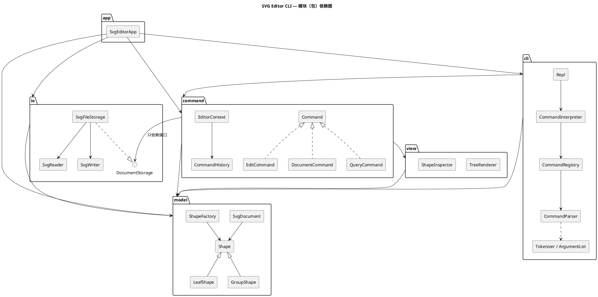

# SVG 编辑器（CLI）—— 设计与过程文档

> 对应 Lab1 Phase 1 说明文档 `phase_cli_1.md` 第 1.2 节要求的四部分：**架构方案 / 过程记录 / 一致性自查 / 质量保证手段**。
> 开发规范、未定细节的决定、版本里程碑见 [`GUIDE.md`](GUIDE.md)；版本变更明细见 [`../CHANGELOG.md`](../CHANGELOG.md)。

---

## 一、架构方案

### 1. 模块划分

代码位于 `src/`，按职责分为 6 个模块（目录）：

| 模块 | 目录 | 职责 | 典型类 |
|---|---|---|---|
| **model**（领域模型） | `src/model/` | SVG 文档的内存模型：图形类层次（Composite）、几何量、可编辑/透传属性、容器与子节点顺序、id 索引、图形工厂、几何备忘录。**不知道**命令、文件、终端的存在 | `Shape` `LeafShape` `RectShape`… `GroupShape` `SvgDocument` `ShapeFactory` `Geometry` |
| **io**（持久化） | `src/io/` | SVG 文本 ⇄ 文档模型：解析（缺 id 自动补、警告）、序列化、文件读写；对外只暴露 `DocumentStorage` 接口 | `DocumentStorage` `SvgFileStorage` `SvgReader` `SvgWriter` `IdAllocator` |
| **view**（文本视图） | `src/view/` | 把模型渲染成人读的文本：`tree` 结构树（属性内联、列对齐）、`show` 属性明细 | `TreeRenderer` `ShapeInspector` |
| **command**（命令） | `src/command/` | **Command 模式**核心：命令接口与三类命令基类、编辑会话上下文、undo/redo 历史栈、全部具体命令。与输入通道（CLI/未来的 agent、鼠标）无关 | `Command` `EditCommand` `DocumentCommand` `QueryCommand` `CommandHistory` `EditorContext` `MoveShapeCommand`… |
| **cli**（命令行通道） | `src/cli/`（含 `parsers/`：每个命令一个解析器类） | 文本命令 → 命令对象：分词（双引号）、参数校验、命令注册表（命令名 → 解析器）、帮助文本、REPL 循环与提示符、注释行、`error:` 输出格式 | `Tokenizer` `ArgumentList` `CommandParser` `CommandRegistry` `CommandInterpreter` `Repl` |
| **app**（组装根） | `src/app/` + `src/main.ts` | Composition Root：创建并连接各模块的具体实现（注册内置图形与命令、注入文件存储），启动 REPL | `SvgEditorApp` |



### 2. 设计模式的选择与落地

| 模式 | 解决的问题 | 落地位置 |
|---|---|---|
| **Command**（必选） | 把"一次编辑"变成对象，统一执行入口，并支持 undo/redo；同时让命令与输入通道解耦 | `command/Command.ts` 接口 `execute(ctx): string[]`；三个抽象基类按"对历史栈的影响"分类：`EditCommand`（可撤销，执行成功后压栈并清空 redo）、`DocumentCommand`（IO 类，执行后设历史屏障）、`QueryCommand`（只读，不入栈）。`CommandHistory` 是 undo/redo 栈（Caretaker）；`cli/CommandInterpreter` 是 Invoker；接收者是 `SvgDocument` |
| **Template Method** | 三类命令"执行 → 记录历史"的骨架相同、细节不同；避免 Invoker 里 `if (cmd instanceof …)` | `EditCommand.execute()` 固定为"取文档 → `perform()` → `history.recordEdit(this)`"；子类只实现 `perform / undo`（`redo` 默认再次 `perform`）。`DocumentCommand`、`QueryCommand` 同理 |
| **Composite** | `g` 与叶子统一操作；容器的 move/scale/delete 递归到子孙 | `Shape`（组件）← `LeafShape`（叶子基类）/ `GroupShape`（组合）；`moveBy / scaleBy / createMemento / svgAttributes / children` 在两侧各自实现，命令代码不区分容器与叶子 |
| **Memento** | move/scale 的撤销若靠"反向运算"会累积浮点误差（`0.1+0.2-0.2≠0.1`） | `Shape.createMemento()` 返回 `ShapeMemento`：叶子为 `GeometryMemento`（几何快照），容器为 `CompositeMemento`（子孙快照的组合）；`restore()` 精确还原。`GroupShape` 也用它保证容器操作"全有或全无"（v0.7.1） |
| **Factory + Registry** | 由类型名（CLI 的 `create rect` / SVG 的 `<rect>`）创建图形对象 | `model/ShapeFactory`：`Map<类型名, ShapeClass>`，内置 6 类在 `app/` 注册。**按名字分派之一，标注为待重构**：插件化阶段演进为 `ShapeProvider` 插槽 |
| **Registry（命令分发）** | 由命令名找到解析器 | `cli/CommandRegistry`：`Map<命令名, CommandParser>`。**按名字分派之二，标注为待重构**：可演进为命令插件插槽 |
| **Strategy** | 几何量在平移时行为不同（x 坐标加 dx、y 坐标加 dy、尺寸不变），缩放时都乘以系数；尺寸不得为负 | `model/GeometryAxis` 接口 + `HorizontalAxis` / `VerticalAxis` / `SizeAxis`；`Geometry` 对每个字段委托给它的轴策略，消除 `if (name === 'x' …)`。同理表现属性的取值规则 `StyleRule` ← `PaintRule` / `LengthRule`（v0.8.9） |
| **Ports & Adapters（依赖倒置）** | 命令需要读写文件，但不应依赖文件系统与 XML 库；测试需要内存替身 | `io/DocumentStorage` 接口（端口）；`SvgFileStorage`（适配器）在 `app/` 注入；测试注入 `InMemoryStorage` |

### 3. 依赖方向规则

```
app ──► cli ──► command ──► view ──► model
 │        │        │                   ▲
 │        └────────┼───────────────────┤
 │                 └──► io(接口) ──────┤
 └──────────────────────────► io ──────┘
```

| # | 规则 | 理由 |
|---|---|---|
| R1 | `model` 不依赖任何其他模块，也不依赖 Node 内置模块与第三方库 | 领域模型是最稳定的核心，应能被任何通道、任何存储复用 |
| R2 | `io` 只依赖 `model`（及 `node:fs`、`@xmldom/xmldom`） | 持久化是模型的"外圈"适配器 |
| R3 | `view` 只依赖 `model` | 文本渲染只读模型 |
| R4 | `command` 只依赖 `model`、`view`，以及 `io` 中的**接口**文件（`DocumentStorage`、`LoadedDocument`），不得依赖 `SvgFileStorage / SvgReader / SvgWriter` | 命令要能被 CLI 以外的通道复用，并能在测试中注入内存存储 |
| R5 | `cli` 只依赖 `command`、`model`；不得依赖 `io`、`view` | CLI 只负责"文本 → 命令对象 → 输出行"，不越级操作存储与渲染 |
| R6 | 只有 `app` 可以依赖全部模块（组装根）；任何模块不得依赖 `app` | 具体实现的选择集中在一处 |
| R7 | 只有 `io` 可以使用 `node:fs` 与 XML 库；只有 `cli`、`app` 可以使用 `node:readline` / `process` | IO 隔离 |
| R8 | 禁止运行时循环依赖；仅类型层面的循环只允许出现在同一模块内部（R8a/R8b） | 循环依赖使模块无法独立理解与测试。Composite 中"组件知道父容器、容器持有组件"是模式固有的双向引用（`Shape` ↔ `Container`），以 `import type` 表达，不产生运行时环（v0.2.0 修订，见过程记录） |

以上规则写成 `.dependency-cruiser.cjs`，`npm run lint:deps` 自动检查；违反即为待处理项。

### 4. 变化点假设

| # | 最可能的变化 | 预留了什么 / 为什么不留 |
|---|---|---|
| V1 | **新增图形类型**（说明文档 4.4 已预告 `box` 复合图形、插件化） | 已留：`ShapeFactory` 是注册表而非 `switch`，新类型只需实现 `Shape` 子类 + 静态 `ShapeClass` 协议（参数 schema、从 SVG 元素构造）并注册；序列化、tree、move/scale/delete 全部经多态接口，无需改动。`Shape.isComposite()` 已为"拒绝 ungroup 复合图形"留钩子，`data-kind` 等未知属性读入时原样透传（未装插件即"降级为普通 g"）。**未做**：插件加载机制本身（下一阶段目标） |
| V2 | **新的输入通道**（说明文档提到 CLI / agent / 鼠标三种通道） | 已留：命令对象只接收类型化参数（id、数字），不认识文本 token；CLI 解析器是独立的一层。新通道直接构造命令对象并交给同一个 `EditorContext` 执行即可 |
| V3 | **新增命令** | 已留：`CommandRegistry` 注册表 + 每个命令一个解析器类；help 文本由注册表自动生成 |
| V4 | **存储/格式变化**（另存为 PNG、从网络读取、自动保存） | 已留：`DocumentStorage` 端口，命令只依赖接口 |
| V5 | **显示格式变化**（tree 显示更多属性、JSON 输出给 agent） | 部分预留：渲染集中在 `view/`；单个图形的摘要由图形自己提供（`summary()`），新增输出格式需新增渲染器 |
| V6 | **`set` 白名单扩展**（opacity、font-size…） | 已留：白名单分散在各图形类（几何字段由 `Geometry` 声明、通用样式由 `PresentationStyle` 声明），扩展只改一处 |
| V7 | **完整 transform 支持**（旋转、对容器 move 改写 transform） | **不留**：本阶段语义明确为"递归改几何属性"；引入变换矩阵会显著增加复杂度而无当前需求。读入的 `transform` 原样透传保证不丢数据 |
| V8 | **结构路径寻址**（`/canvas/g1/rect[2]`） | **不留**：说明文档明确本阶段不要求；所有命令经 `SvgDocument.requireShape(id)` 统一定位，届时只需替换这一个入口 |
| V9 | **跨 IO 的撤销**（保存后仍可撤销） | **不留**：说明文档规定 IO 后禁止 undo；历史屏障实现最简单。若需求变化，只需修改 `CommandHistory.markIoBarrier()` |

---

## 二、过程记录

这个项目我用 AI 编程智能体（Claude Code）完成。我负责定任务、定规则、定交付形式，并发起测试和复查：要求 AI 全面测试、出了问题要它修正，"做好了"的地方要它拿证据。方案、代码、测试和文档的具体编写主要由 AI 完成。下面按时间记录关键的几段，每条都能在 git 提交、tag 和 `CHANGELOG.md` 里找到对应。

### 1. 开头：先定规则（10-27，v0.1.0）

第一条指令里我就把流程定下来了："请你先写出指导文档，接着不断实现代码细节，最后进行测试检验系统质量"；测试中发现的错误，要按 GitHub 惯例用 vx.x.x 记录（大版本、模块更新、修正）。

这样安排，是为了让开发过程留下可以检查的痕迹：每加一个模块就是一个 MINOR 版本，每修一个 bug 就是一个 PATCH 版本。

我和CC交互了之后先写了 `doc/GUIDE.md`，把需求文档里没写死的细节逐条定成决定（最初 17 条，最后 24 条），比如 IO 命令之后能不能 undo、`group` 出来的新容器放在什么位置。之后的实现和测试都以这份文档为准。

### 2. 模块开发中的设计修正（v0.2.0 – v0.6.0）

编码阶段，AI 在实现和单元测试中修正了几处设计：

- **依赖规则过严**：最初规定"全局禁止循环依赖"，自动检查报出 7 处循环。这些循环都只存在于类型层面，是 Composite 模式固有的，于是改为"禁止运行时循环、禁止跨模块循环"。
- **撤销改用快照**：用反向移动来撤销 `move`，`0.1 + 0.2 - 0.2` 回不到 `0.1`。改为执行前保存快照，撤销时原样恢复（Memento）。
- **命令与输入解耦**：命令原本直接接收 CLI 的字符串参数，改为由 CLI 构造好对象再交给命令，方便以后接入别的输入方式。

### 3. 我要求的全面测试：检出并修复 14 个 bug（v0.7.0 – v1.0.1）

按我第一条指令的要求，模块写完后进入系统测试。测试分几轮进行：

- **规格测试**：用需求文档 §6 的完整会话做端到端回放，按章节逐条验收 §4.2 的错误表、§4.3 的撤销规则和 §5 的显示格式。
- **自查**：检出 BUG-1，`scale` 之后数值溢出成 `Infinity`，保存出的文件也不合法。
- **独立黑盒测试**：由一个看不到源码、只拿到需求文档的测试代理专门找漏洞，检出 BUG-2 到 BUG-12，共 11 个。修 BUG-12 时又顺带查出 BUG-13。
- **交付位置复验**：在交付目录原地跑全部测试，检出 BUG-14：网络盘上架构测试超时。

检出的 bug 里比较严重的有：

| bug | 问题 | 修正后 |
|---|---|---|
| BUG-2 | 嵌套很深时 `delete` 执行到一半栈溢出，文档被改坏 | 限制最大嵌套层数，并在修改之前先检查 |
| BUG-3 | 读入带命名空间的文件后，`ungroup` 再保存，得到的文件读不回来 | 读入时把命名空间声明提到根元素 |
| BUG-4 | 保存时数值被截到 6 位小数，小图形直接消失 | 显示用 6 位、存盘用 15 位有效数字 |
| BUG-5 | 带 BOM 的文件（Windows 记事本常见）读不进来 | 解析前去掉 BOM |
| BUG-7 | 文字里的连续空格，保存再读回后丢失 | 写出时加 `xml:space="preserve"` |

所有 bug 我都让 AI 修正，并按我定的规则逐个发修正版本：每个 bug 一个 PATCH，即 v0.7.1、v0.8.1–v0.8.12、v1.0.1。每个修正都先写出能复现问题的回归测试（`test/regression/Defects.test.ts`，按 bug 编号命名），修完再跑全部测试，`CHANGELOG.md` 里写明现象、原因和修正。

测试中还查出一处不是 bug、而是当初的决定错了：读入图标文件再原样保存，`viewBox` 被改写，图形缩小一半。我让 AI 修改决定 D9，改为保留原 viewBox。因为这改变了已经写下的规则，按 MINOR 发版本 v0.9.0。

### 4. 交付后的追问：查出 AI 自己的遗漏（10-28）

- 我问最终的交付产物在哪里，然后让它写交接说明，好把压缩包顺利交接给我。它写了 `HANDOFF.md`，并模拟演练了一次推送。
- 我问"那么你现在打包好了么"。AI 这才承认**其实还没打包**：之前那个只是验证用的临时包，验证完已经删了。随后它正式打包，并解压出来核对了一遍。
- 我问"你确定这个包有先前的提交记录么"。它从压缩包里查给我看：73 个提交，24 个版本 tag 加 `final`。它同时说明提交时间是真实的，不能修改；要展示版本迭代，可以用 GitHub Release。

### 5. 对照原始需求复查（10-31）

我问"现在你确定最新一版可以完成最初任务文档中的要求了么"，让它直接拿需求文档复查。

- 它第一次逐行比对时，几乎每行都对不上，查下来是它自己的比对脚本写错了，不是程序的问题。
- 改正脚本后结果是：§6 正文 57/57 行逐字一致；§6.1 正文 47 行中 42 行逐字一致，其余 5 行只差对齐空格。
- 它另外列出了 3 处与需求文档的小差异。

### 6. "你自己测试过了么"：查出测试方法本身的缺陷（10-31）

我让 AI 教我怎么做测试，然后追问："你刚才给我的这些测试，你自己测试过了么，不允许凭借印象，请你真实查看记录。"

它查了执行记录后承认：只验证了一部分，而且是在本地副本里跑的，不是它让我用的交付目录。在我的要求下，它在交付目录里重新跑，查出两个问题：

- 它教我在仓库根目录 `save test.svg`，这会让 git 工作区变脏，打包前"工作区干净"的核对就过不去。
- 在交付目录（网络盘）跑 `npm test`，21 个测试进程启动时全部超时，一个测试都没跑起来。原因是这台机器有 384 个核，进程同时启动，而网络盘当天非常慢。

我让它修正测试方法：改为先解压到本地磁盘、`npm ci` 后再测，测试时保存的文件存到 `/tmp`。它从压缩包开始把整个流程完整走了一遍，414 个测试全部通过，工作区保持干净。

### 小结

- 我在这个项目里的作用主要有三点：一开始定规则（先写文档、全面测试、每个 bug 单独发修正版本）；在测试阶段要求修复检出的全部 bug；交付后不断追问，比如"确定满足需求了么""你自己测试过了么""测试有log记录么，在哪里让我查看""和我的回复全部都是真实有依据的么，不允许凭借印象和推测"。
- AI 写代码很快，但会把"打算做"说成"做好了"，也会把"本地通过"当成"交付位置通过"。要求它"查看真实记录"、在真实环境里复验，比让它再保证一次更有效。

## 三、一致性自查

### 1. 模块划分：实际目录与方案是否一致？

**一致**。实际 `src/` 目录与第一部分的 6 个模块一一对应，没有方案之外的模块：

| 模块 | 文件数 | 与方案的差异（均已记入 CHANGELOG / 过程记录） |
|---|---|---|
| `model/` | 32 | 修正缺陷时新增 `XmlCharacters`（v0.8.7）、`StyleRule` / `PaintRule` / `LengthRule`（v0.8.9），职责仍属领域模型；`Shape.removeAttribute` 被 `restoreAttribute` 取代（v0.8.9） |
| `io/` | 8 | 新增 `SvgWhitespace`（v0.8.6） |
| `view/` | 2 | 无 |
| `command/` | 29 | 无（`Quantity` 为输出措辞的单复数辅助类，v0.5.0 起即存在） |
| `cli/` | 27 | 解析器放在子目录 `cli/parsers/`（20 个），方案初稿未写明子目录，已补入第一部分的模块表 |
| `app/` + `main.ts` | 2 | 无 |

对照时还发现并修正了**文档与代码的不一致**：设计模式表把 `EditCommand` 的模板方法写成 `apply()`，代码中实际叫 `perform()`（文档在 v0.5.0 实现时改了名而文档未跟上），已更正。方案本身的两次修订——R8 拆分为 R8a/R8b（v0.2.0）、决定 D9 改为保留 viewBox（v0.9.0）——都在过程记录中说明了原因。

### 2. 依赖方向：规则有没有被违反？

**没有违反**。证据有三层：

1. **自动检查**：`npm run lint:deps`（dependency-cruiser，R1–R8 全部规则）结果为 `no dependency violations found (104 modules, 349 dependencies cruised)`（104 个模块 = 100 个源文件 + Node 内置模块与 xmldom），每个版本 tag 都检查过。
2. **从代码生成的模块依赖图**（`depcruise --collapse '^src/[^/]+/'`）与方案逐条比对：

   | 实际存在的模块依赖 | 方案是否允许 |
   |---|---|
   | `app → cli, command, io, model` | R6 ✔ |
   | `cli → command, model, readline` | R5、R7 ✔ |
   | `command → model, view, io` | R4 ✔（io 仅 `DocumentStorage`，见下） |
   | `view → model` | R3 ✔ |
   | `io → model, fs, @xmldom/xmldom` | R2、R7 ✔ |
   | `model →`（无） | R1 ✔ |
   | `main.ts → app` | R6 ✔ |

3. **人工抽样**：`grep "from '../io/" src/command` 只有一处 `import type { DocumentStorage }`（R4b）；`cli/` 的 50 条跨目录导入全部指向 `command/`（43 条）或 `model/`（7 条）（R5）；`src/` 中 `switch` 出现 0 次，`instanceof` 只用于错误类型（2.1 范式）。

另外验证了**检查本身有效**：在一份临时副本中故意加入 5 条违规依赖（model→command、command→SvgReader、view→fs、cli→view、io→app），`lint:deps` 全部按预期的规则（R1、R4b、R7a、R5、R2/R6，以及由此产生的 R8a/R8b 循环）报错。

## 四、质量保证手段

### 1. 功能完整性：说明文档的每条要求都有测试对应

| 说明文档 | 测试 | 方式 |
|---|---|---|
| 第 6 节典型会话、6.1 节流程图 | `test/e2e/SpecTranscripts.test.ts` | **真实子进程**回放命令脚本，与说明文档中的 transcript **逐行比对**（脚本与期望输出由程序从说明文档中提取，避免手抄错误）；保存出的 SVG 与**手写**的期望文件逐字节比对 |
| 0.1 节 SVG 示例 | `test/io/SvgWriter.test.ts` | 输出与示例逐字节一致 |
| 2 通用约定、2.1 Composite、3 命令语义、4.1 参数与白名单、4.2 错误表**每一行**、4.3 undo 粒度、5 显示格式 | `test/spec/SpecConformance.test.ts` | 按章节组织；每个错误场景同时断言"输出恰为一行 `error: …`"与"文档 + undo/redo 栈 + 路径快照不变" |
| 4.4 box（本阶段不实现） | `SpecConformance` / `Shapes.test` | `create box` 报 `unknown shape type: box (is the plugin loaded?)`；`ungroup` 复合图形的钩子用测试替身验证 |
| 2.1 实现范式 | `test/architecture/Paradigm.test.ts` | 每个文件恰一个同名类/接口、无自由函数、无 `switch`、`instanceof` 只用于错误、按名字分派只在两个标注"待重构"的注册表 |

### 2. 代码质量的依据

| 手段 | 结果 |
|---|---|
| 分层自动化测试 | **414 个测试全部通过**：model 78、io 23、view 9、command 80、cli 22、spec 40、e2e 3、regression 55、architecture 104 |
| 覆盖率（v8） | 语句 **98.95%**、分支 **94.5%**、函数 98.6%；未覆盖的主要是"不应发生"的防御性断言（如 `ChildList` 对重复挂载的检查） |
| 结构不变量 | 测试辅助 `DocumentInvariants` 在命令层每条命令之后检查 id 索引 ⇔ 树、父指针、id 唯一；`roundTrip()` 断言每条编辑命令 undo 后与执行前**逐字节相同**、redo 后与执行后逐字节相同 |
| 静态检查 | TypeScript `strict` + `noImplicitOverride` + `noUnused*`；`npm run check` = 类型检查 + 依赖规则 + 全部测试 |
| 依赖规则 | dependency-cruiser 自动检查 R1–R8，并做过"故意违规"验证检查有效（第三部分） |
| 独立黑盒测试 | 不看源码的独立测试者做对抗式测试，检出 BUG-2…BUG-12 共 11 个缺陷和 1 个设计问题（D9），全部复现、修正并留有回归测试（过程记录第 3 节） |
| 缺陷可追溯 | 14 个缺陷（BUG-1…BUG-14）各有独立 PATCH 版本、CHANGELOG 中的"现象 / 原因 / 修正"、`test/regression/Defects.test.ts` 中以缺陷编号命名的回归测试 |
| 交付位置原地复验 | 在交付目录（网络文件系统）运行 `npm run check`：v1.0.0 时发现 5 个架构测试超时（BUG-14），v1.0.1 修正后通过。10-31 再次原地复验时网络盘异常缓慢，测试进程启动全部超时、测试未能运行（不是代码问题）；因此测试方法改为先解压到本地磁盘再运行，按此从交付压缩包完整验证，414 个测试全部通过（过程记录第 6 节） |
| 每个版本都可用 | 交付前对全部 tag 逐个检出，运行类型检查与**该版本自带**的测试：全部通过（v0.1.0 只有工程骨架与文档，仅类型检查），结果见下表 |

| 版本 | 类型检查 | 该版本自带的测试 |
|---|---|---|
| v0.1.0 | ✔ | （尚无测试） |
| v0.2.0 | ✔ | Tests 69 passed (69) |
| v0.3.0 | ✔ | Tests 91 passed (91) |
| v0.4.0 | ✔ | Tests 100 passed (100) |
| v0.5.0 | ✔ | Tests 180 passed (180) |
| v0.6.0 | ✔ | Tests 202 passed (202) |
| v0.7.0 | ✔ | Tests 245 passed (245) |
| v0.7.1 | ✔ | Tests 249 passed (249) |
| v0.8.0 | ✔ | Tests 348 passed (348) |
| v0.8.1 | ✔ | Tests 353 passed (353) |
| v0.8.2 | ✔ | Tests 357 passed (357) |
| v0.8.3 | ✔ | Tests 368 passed (368) |
| v0.8.4 | ✔ | Tests 370 passed (370) |
| v0.8.5 | ✔ | Tests 373 passed (373) |
| v0.8.6 | ✔ | Tests 377 passed (377) |
| v0.8.7 | ✔ | Tests 384 passed (384) |
| v0.8.8 | ✔ | Tests 386 passed (386) |
| v0.8.9 | ✔ | Tests 403 passed (403) |
| v0.8.10 | ✔ | Tests 404 passed (404) |
| v0.8.11 | ✔ | Tests 408 passed (408) |
| v0.8.12 | ✔ | Tests 410 passed (410) |
| v0.9.0 | ✔ | Tests 414 passed (414) |

### 3. 已知局限（如实说明）

- **transform 与 move/scale**（D5、V7）：`move`/`scale` 修改几何属性，增量按图形自身的用户坐标解释；对带 `transform="scale(2)"` 的容器 `move 5 5`，屏幕上移动 10 px，回显仍为 `moved by (5,5)`。
- **读入的取舍**：不支持的元素（`path`、`defs`…）跳过并警告；叶子图形的子元素（`title`、`animate`）丢弃并警告；内部 DTD 实体（`<!ENTITY>`）不支持。
- **颜色值**不做语法校验（只要求非空）；`stroke-width` 校验为非负长度。
- **嵌套深度**上限 500 层（D23）。
- 交互模式依赖终端的行编辑；脚本模式（重定向 stdin）会回显命令，便于生成 transcript。
