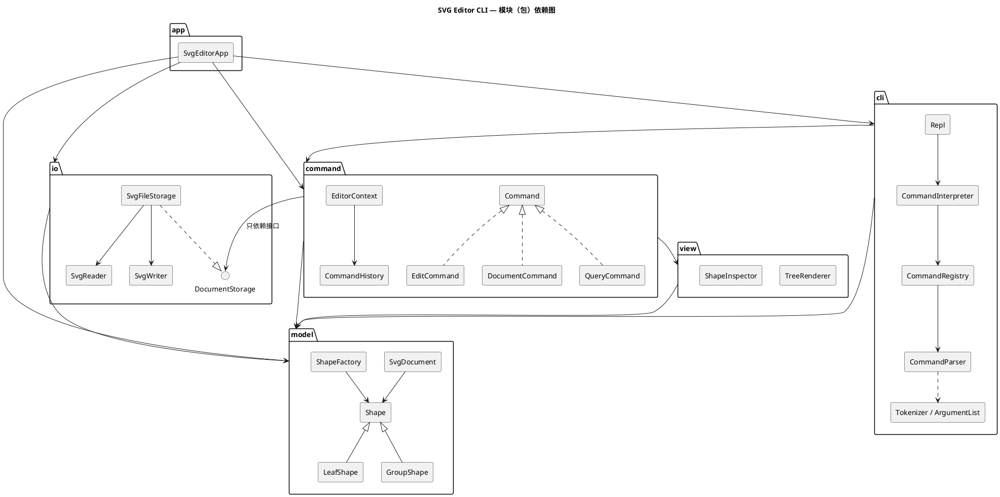

# SVG 编辑器（CLI）—— 设计与过程文档

> 对应 Lab1 Phase 1 说明文档 `phase_cli_1.md` 第 1.2 节要求的四部分：**架构方案 / 过程记录 / 一致性自查 / 质量保证手段**。
> 开发规范、未定细节的决定、版本里程碑见 [`GUIDE.md`](GUIDE.md)；版本变更明细见 [`../CHANGELOG.md`](../CHANGELOG.md)。

---

## 一、架构方案

### 1. 模块划分

代码位于 `src/`，按职责分为 6 个模块（目录）：

| 模块 | 目录 | 职责 | 典型类 |
|---|---|---|---|
| **model**（领域模型） | `src/model/` | SVG 文档的内存模型：图形类层次（Composite）、几何量、可编辑/透传属性、容器与子节点顺序、id 索引、图形工厂、几何备忘录。**不知道**命令、文件、终端的存在 | `Shape` `LeafShape` `RectShape`… `GroupShape` `SvgDocument` `ShapeFactory` `Geometry` |
| **io**（持久化） | `src/io/` | SVG 文本 ⇄ 文档模型：解析（缺 id 自动补、警告）、序列化、文件读写；对外只暴露 `DocumentStorage` 接口 | `DocumentStorage` `SvgFileStorage` `SvgReader` `SvgWriter` `IdAllocator` |
| **view**（文本视图） | `src/view/` | 把模型渲染成人读的文本：`tree` 结构树（属性内联、列对齐）、`show` 属性明细 | `TreeRenderer` `ShapeInspector` |
| **command**（命令） | `src/command/` | **Command 模式**核心：命令接口与三类命令基类、编辑会话上下文、undo/redo 历史栈、全部具体命令。与输入通道（CLI/未来的 agent、鼠标）无关 | `Command` `EditCommand` `DocumentCommand` `QueryCommand` `CommandHistory` `EditorContext` `MoveShapeCommand`… |
| **cli**（命令行通道） | `src/cli/` | 文本命令 → 命令对象：分词（双引号）、参数校验、命令注册表（命令名 → 解析器）、帮助文本、REPL 循环与提示符、注释行、`error:` 输出格式 | `Tokenizer` `ArgumentList` `CommandParser` `CommandRegistry` `CommandInterpreter` `Repl` |
| **app**（组装根） | `src/app/` + `src/main.ts` | Composition Root：创建并连接各模块的具体实现（注册内置图形与命令、注入文件存储），启动 REPL | `SvgEditorApp` |



### 2. 设计模式的选择与落地

| 模式 | 解决的问题 | 落地位置 |
|---|---|---|
| **Command**（必选） | 把"一次编辑"变成对象，统一执行入口，并支持 undo/redo；同时让命令与输入通道解耦 | `command/Command.ts` 接口 `execute(ctx): string[]`；三个抽象基类按"对历史栈的影响"分类：`EditCommand`（可撤销，执行成功后压栈并清空 redo）、`DocumentCommand`（IO 类，执行后设历史屏障）、`QueryCommand`（只读，不入栈）。`CommandHistory` 是 undo/redo 栈（Caretaker）；`cli/CommandInterpreter` 是 Invoker；接收者是 `SvgDocument` |
| **Template Method** | 三类命令"执行 → 记录历史"的骨架相同、细节不同；避免 Invoker 里 `if (cmd instanceof …)` | `EditCommand.execute()` 固定为"取文档 → `apply()` → `history.recordEdit(this)`"；子类只实现 `apply / undo`。`DocumentCommand`、`QueryCommand` 同理 |
| **Composite** | `g` 与叶子统一操作；容器的 move/scale/delete 递归到子孙 | `Shape`（组件）← `LeafShape`（叶子基类）/ `GroupShape`（组合）；`moveBy / scaleBy / createMemento / svgAttributes / children` 在两侧各自实现，命令代码不区分容器与叶子 |
| **Memento** | move/scale 的撤销若靠"反向运算"会累积浮点误差（`0.1+0.2-0.2≠0.1`） | `Shape.createMemento()` 返回 `ShapeMemento`：叶子为 `GeometryMemento`（几何快照），容器为 `CompositeMemento`（子孙快照的组合）；`restore()` 精确还原 |
| **Factory + Registry** | 由类型名（CLI 的 `create rect` / SVG 的 `<rect>`）创建图形对象 | `model/ShapeFactory`：`Map<类型名, ShapeClass>`，内置 6 类在 `app/` 注册。**按名字分派之一，标注为待重构**：插件化阶段演进为 `ShapeProvider` 插槽 |
| **Registry（命令分发）** | 由命令名找到解析器 | `cli/CommandRegistry`：`Map<命令名, CommandParser>`。**按名字分派之二，标注为待重构**：可演进为命令插件插槽 |
| **Strategy** | 几何量在平移时行为不同（x 坐标加 dx、y 坐标加 dy、尺寸不变），缩放时都乘以系数；尺寸不得为负 | `model/GeometryAxis` 接口 + `HorizontalAxis` / `VerticalAxis` / `SizeAxis`；`Geometry` 对每个字段委托给它的轴策略，消除 `if (name === 'x' …)` |
| **Ports & Adapters（依赖倒置）** | 命令需要读写文件，但不应依赖文件系统与 XML 库；测试需要内存替身 | `io/DocumentStorage` 接口（端口）；`SvgFileStorage`（适配器）在 `app/` 注入；测试注入 `InMemoryStorage` |

### 3. 依赖方向规则

```
app ──► cli ──► command ──► view ──► model
 │        │        │                   ▲
 │        └────────┼───────────────────┤
 │                 └──► io(接口) ──────┤
 └──────────────────────────► io ──────┘
```

| # | 规则 | 理由 |
|---|---|---|
| R1 | `model` 不依赖任何其他模块，也不依赖 Node 内置模块与第三方库 | 领域模型是最稳定的核心，应能被任何通道、任何存储复用 |
| R2 | `io` 只依赖 `model`（及 `node:fs`、`@xmldom/xmldom`） | 持久化是模型的"外圈"适配器 |
| R3 | `view` 只依赖 `model` | 文本渲染只读模型 |
| R4 | `command` 只依赖 `model`、`view`，以及 `io` 中的**接口**文件（`DocumentStorage`、`LoadedDocument`），不得依赖 `SvgFileStorage / SvgReader / SvgWriter` | 命令要能被 CLI 以外的通道复用，并能在测试中注入内存存储 |
| R5 | `cli` 只依赖 `command`、`model`；不得依赖 `io`、`view` | CLI 只负责"文本 → 命令对象 → 输出行"，不越级操作存储与渲染 |
| R6 | 只有 `app` 可以依赖全部模块（组装根）；任何模块不得依赖 `app` | 具体实现的选择集中在一处 |
| R7 | 只有 `io` 可以使用 `node:fs` 与 XML 库；只有 `cli`、`app` 可以使用 `node:readline` / `process` | IO 隔离 |
| R8 | 全局禁止循环依赖 | 循环依赖使模块无法独立理解与测试 |

以上规则写成 `.dependency-cruiser.cjs`，`npm run lint:deps` 自动检查；违反即为待处理项。

### 4. 变化点假设

| # | 最可能的变化 | 预留了什么 / 为什么不留 |
|---|---|---|
| V1 | **新增图形类型**（说明文档 4.4 已预告 `box` 复合图形、插件化） | 已留：`ShapeFactory` 是注册表而非 `switch`，新类型只需实现 `Shape` 子类 + 静态 `ShapeClass` 协议（参数 schema、从 SVG 元素构造）并注册；序列化、tree、move/scale/delete 全部经多态接口，无需改动。`Shape.isComposite()` 已为"拒绝 ungroup 复合图形"留钩子，`data-kind` 等未知属性读入时原样透传（未装插件即"降级为普通 g"）。**未做**：插件加载机制本身（下一阶段目标） |
| V2 | **新的输入通道**（说明文档提到 CLI / agent / 鼠标三种通道） | 已留：命令对象只接收类型化参数（id、数字），不认识文本 token；CLI 解析器是独立的一层。新通道直接构造命令对象并交给同一个 `EditorContext` 执行即可 |
| V3 | **新增命令** | 已留：`CommandRegistry` 注册表 + 每个命令一个解析器类；help 文本由注册表自动生成 |
| V4 | **存储/格式变化**（另存为 PNG、从网络读取、自动保存） | 已留：`DocumentStorage` 端口，命令只依赖接口 |
| V5 | **显示格式变化**（tree 显示更多属性、JSON 输出给 agent） | 部分预留：渲染集中在 `view/`；单个图形的摘要由图形自己提供（`summary()`），新增输出格式需新增渲染器 |
| V6 | **`set` 白名单扩展**（opacity、font-size…） | 已留：白名单分散在各图形类（几何字段由 `Geometry` 声明、通用样式由 `PresentationStyle` 声明），扩展只改一处 |
| V7 | **完整 transform 支持**（旋转、对容器 move 改写 transform） | **不留**：本阶段语义明确为"递归改几何属性"；引入变换矩阵会显著增加复杂度而无当前需求。读入的 `transform` 原样透传保证不丢数据 |
| V8 | **结构路径寻址**（`/canvas/g1/rect[2]`） | **不留**：说明文档明确本阶段不要求；所有命令经 `SvgDocument.requireShape(id)` 统一定位，届时只需替换这一个入口 |
| V9 | **跨 IO 的撤销**（保存后仍可撤销） | **不留**：说明文档规定 IO 后禁止 undo；历史屏障实现最简单。若需求变化，只需修改 `CommandHistory.markIoBarrier()` |

---

## 二、过程记录

（开发过程中逐步填写，见各版本。）

## 三、一致性自查

（实现完成后填写。）

## 四、质量保证手段

（实现完成后填写。）
