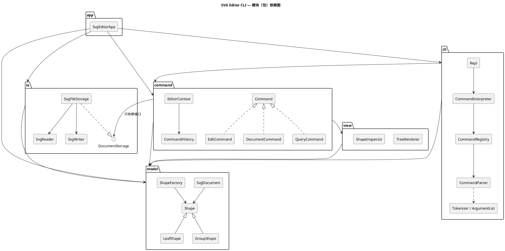

# SVG 编辑器（CLI）—— 设计与过程文档

> 对应 Lab1 Phase 1 说明文档 `phase_cli_1.md` 第 1.2 节要求的四部分：**架构方案 / 过程记录 / 一致性自查 / 质量保证手段**。
> 开发规范、未定细节的决定、版本里程碑见 [`GUIDE.md`](GUIDE.md)；版本变更明细见 [`../CHANGELOG.md`](../CHANGELOG.md)。

---

## 一、架构方案

### 1. 模块划分

代码位于 `src/`，按职责分为 6 个模块（目录）：

| 模块 | 目录 | 职责 | 典型类 |
|---|---|---|---|
| **model**（领域模型） | `src/model/` | SVG 文档的内存模型：图形类层次（Composite）、几何量、可编辑/透传属性、容器与子节点顺序、id 索引、图形工厂、几何备忘录。**不知道**命令、文件、终端的存在 | `Shape` `LeafShape` `RectShape`… `GroupShape` `SvgDocument` `ShapeFactory` `Geometry` |
| **io**（持久化） | `src/io/` | SVG 文本 ⇄ 文档模型：解析（缺 id 自动补、警告）、序列化、文件读写；对外只暴露 `DocumentStorage` 接口 | `DocumentStorage` `SvgFileStorage` `SvgReader` `SvgWriter` `IdAllocator` |
| **view**（文本视图） | `src/view/` | 把模型渲染成人读的文本：`tree` 结构树（属性内联、列对齐）、`show` 属性明细 | `TreeRenderer` `ShapeInspector` |
| **command**（命令） | `src/command/` | **Command 模式**核心：命令接口与三类命令基类、编辑会话上下文、undo/redo 历史栈、全部具体命令。与输入通道（CLI/未来的 agent、鼠标）无关 | `Command` `EditCommand` `DocumentCommand` `QueryCommand` `CommandHistory` `EditorContext` `MoveShapeCommand`… |
| **cli**（命令行通道） | `src/cli/`（含 `parsers/`：每个命令一个解析器类） | 文本命令 → 命令对象：分词（双引号）、参数校验、命令注册表（命令名 → 解析器）、帮助文本、REPL 循环与提示符、注释行、`error:` 输出格式 | `Tokenizer` `ArgumentList` `CommandParser` `CommandRegistry` `CommandInterpreter` `Repl` |
| **app**（组装根） | `src/app/` + `src/main.ts` | Composition Root：创建并连接各模块的具体实现（注册内置图形与命令、注入文件存储），启动 REPL | `SvgEditorApp` |



### 2. 设计模式的选择与落地

| 模式 | 解决的问题 | 落地位置 |
|---|---|---|
| **Command**（必选） | 把"一次编辑"变成对象，统一执行入口，并支持 undo/redo；同时让命令与输入通道解耦 | `command/Command.ts` 接口 `execute(ctx): string[]`；三个抽象基类按"对历史栈的影响"分类：`EditCommand`（可撤销，执行成功后压栈并清空 redo）、`DocumentCommand`（IO 类，执行后设历史屏障）、`QueryCommand`（只读，不入栈）。`CommandHistory` 是 undo/redo 栈（Caretaker）；`cli/CommandInterpreter` 是 Invoker；接收者是 `SvgDocument` |
| **Template Method** | 三类命令"执行 → 记录历史"的骨架相同、细节不同；避免 Invoker 里 `if (cmd instanceof …)` | `EditCommand.execute()` 固定为"取文档 → `perform()` → `history.recordEdit(this)`"；子类只实现 `perform / undo`（`redo` 默认再次 `perform`）。`DocumentCommand`、`QueryCommand` 同理 |
| **Composite** | `g` 与叶子统一操作；容器的 move/scale/delete 递归到子孙 | `Shape`（组件）← `LeafShape`（叶子基类）/ `GroupShape`（组合）；`moveBy / scaleBy / createMemento / svgAttributes / children` 在两侧各自实现，命令代码不区分容器与叶子 |
| **Memento** | move/scale 的撤销若靠"反向运算"会累积浮点误差（`0.1+0.2-0.2≠0.1`） | `Shape.createMemento()` 返回 `ShapeMemento`：叶子为 `GeometryMemento`（几何快照），容器为 `CompositeMemento`（子孙快照的组合）；`restore()` 精确还原。`GroupShape` 也用它保证容器操作"全有或全无"（v0.7.1） |
| **Factory + Registry** | 由类型名（CLI 的 `create rect` / SVG 的 `<rect>`）创建图形对象 | `model/ShapeFactory`：`Map<类型名, ShapeClass>`，内置 6 类在 `app/` 注册。**按名字分派之一，标注为待重构**：插件化阶段演进为 `ShapeProvider` 插槽 |
| **Registry（命令分发）** | 由命令名找到解析器 | `cli/CommandRegistry`：`Map<命令名, CommandParser>`。**按名字分派之二，标注为待重构**：可演进为命令插件插槽 |
| **Strategy** | 几何量在平移时行为不同（x 坐标加 dx、y 坐标加 dy、尺寸不变），缩放时都乘以系数；尺寸不得为负 | `model/GeometryAxis` 接口 + `HorizontalAxis` / `VerticalAxis` / `SizeAxis`；`Geometry` 对每个字段委托给它的轴策略，消除 `if (name === 'x' …)`。同理表现属性的取值规则 `StyleRule` ← `PaintRule` / `LengthRule`（v0.8.9） |
| **Ports & Adapters（依赖倒置）** | 命令需要读写文件，但不应依赖文件系统与 XML 库；测试需要内存替身 | `io/DocumentStorage` 接口（端口）；`SvgFileStorage`（适配器）在 `app/` 注入；测试注入 `InMemoryStorage` |

### 3. 依赖方向规则

```
app ──► cli ──► command ──► view ──► model
 │        │        │                   ▲
 │        └────────┼───────────────────┤
 │                 └──► io(接口) ──────┤
 └──────────────────────────► io ──────┘
```

| # | 规则 | 理由 |
|---|---|---|
| R1 | `model` 不依赖任何其他模块，也不依赖 Node 内置模块与第三方库 | 领域模型是最稳定的核心，应能被任何通道、任何存储复用 |
| R2 | `io` 只依赖 `model`（及 `node:fs`、`@xmldom/xmldom`） | 持久化是模型的"外圈"适配器 |
| R3 | `view` 只依赖 `model` | 文本渲染只读模型 |
| R4 | `command` 只依赖 `model`、`view`，以及 `io` 中的**接口**文件（`DocumentStorage`、`LoadedDocument`），不得依赖 `SvgFileStorage / SvgReader / SvgWriter` | 命令要能被 CLI 以外的通道复用，并能在测试中注入内存存储 |
| R5 | `cli` 只依赖 `command`、`model`；不得依赖 `io`、`view` | CLI 只负责"文本 → 命令对象 → 输出行"，不越级操作存储与渲染 |
| R6 | 只有 `app` 可以依赖全部模块（组装根）；任何模块不得依赖 `app` | 具体实现的选择集中在一处 |
| R7 | 只有 `io` 可以使用 `node:fs` 与 XML 库；只有 `cli`、`app` 可以使用 `node:readline` / `process` | IO 隔离 |
| R8 | 禁止运行时循环依赖；仅类型层面的循环只允许出现在同一模块内部（R8a/R8b） | 循环依赖使模块无法独立理解与测试。Composite 中"组件知道父容器、容器持有组件"是模式固有的双向引用（`Shape` ↔ `Container`），以 `import type` 表达，不产生运行时环（v0.2.0 修订，见过程记录） |

以上规则写成 `.dependency-cruiser.cjs`，`npm run lint:deps` 自动检查；违反即为待处理项。

### 4. 变化点假设

| # | 最可能的变化 | 预留了什么 / 为什么不留 |
|---|---|---|
| V1 | **新增图形类型**（说明文档 4.4 已预告 `box` 复合图形、插件化） | 已留：`ShapeFactory` 是注册表而非 `switch`，新类型只需实现 `Shape` 子类 + 静态 `ShapeClass` 协议（参数 schema、从 SVG 元素构造）并注册；序列化、tree、move/scale/delete 全部经多态接口，无需改动。`Shape.isComposite()` 已为"拒绝 ungroup 复合图形"留钩子，`data-kind` 等未知属性读入时原样透传（未装插件即"降级为普通 g"）。**未做**：插件加载机制本身（下一阶段目标） |
| V2 | **新的输入通道**（说明文档提到 CLI / agent / 鼠标三种通道） | 已留：命令对象只接收类型化参数（id、数字），不认识文本 token；CLI 解析器是独立的一层。新通道直接构造命令对象并交给同一个 `EditorContext` 执行即可 |
| V3 | **新增命令** | 已留：`CommandRegistry` 注册表 + 每个命令一个解析器类；help 文本由注册表自动生成 |
| V4 | **存储/格式变化**（另存为 PNG、从网络读取、自动保存） | 已留：`DocumentStorage` 端口，命令只依赖接口 |
| V5 | **显示格式变化**（tree 显示更多属性、JSON 输出给 agent） | 部分预留：渲染集中在 `view/`；单个图形的摘要由图形自己提供（`summary()`），新增输出格式需新增渲染器 |
| V6 | **`set` 白名单扩展**（opacity、font-size…） | 已留：白名单分散在各图形类（几何字段由 `Geometry` 声明、通用样式由 `PresentationStyle` 声明），扩展只改一处 |
| V7 | **完整 transform 支持**（旋转、对容器 move 改写 transform） | **不留**：本阶段语义明确为"递归改几何属性"；引入变换矩阵会显著增加复杂度而无当前需求。读入的 `transform` 原样透传保证不丢数据 |
| V8 | **结构路径寻址**（`/canvas/g1/rect[2]`） | **不留**：说明文档明确本阶段不要求；所有命令经 `SvgDocument.requireShape(id)` 统一定位，届时只需替换这一个入口 |
| V9 | **跨 IO 的撤销**（保存后仍可撤销） | **不留**：说明文档规定 IO 后禁止 undo；历史屏障实现最简单。若需求变化，只需修改 `CommandHistory.markIoBarrier()` |

---

## 二、过程记录

按时间顺序记录有代表性的讨论、发现的问题与纠正。每条对应 CHANGELOG 中的一个版本。

### P1（v0.1.0）指导文档先行：先把说明文档的"空白处"变成决定
通读说明文档后发现约 17 处未写死的细节（IO 后 undo 栈如何处理、`group` 新容器放在哪里、读入未知元素怎么办……）。没有让 AI 直接写代码，而是先在 `GUIDE.md` 第 4 节逐条给出决定与理由（D1–D17），之后所有实现与测试都以这张表为准。例如 D4"新容器放在文档序第一个成员的位置"是从说明文档 transcript（`group markers c1 box` 后 markers 恰在原 c1 处）反推出来的，而不是凭感觉。

### P2（v0.2.0）依赖规则 R8 初稿过严，被工具推翻后修订
初稿 R8 写的是"全局禁止循环依赖"。model 实现后运行 `npm run lint:deps`，dependency-cruiser 报告 7 处循环，如 `Container.ts → Shape.ts → Container.ts`。逐条分析后确认：它们全部是 `import type` 的"组件知道父容器、容器持有组件"双向引用，是 Composite 模式固有的，且不存在运行时环（若存在，`class GroupShape extends Shape` 会在加载时得到 `undefined` 父类而崩溃）。因此修订规则而不是扭曲设计：R8a 禁止**运行时**循环，R8b 禁止任何**跨模块**循环。教训：规则写成可执行检查后，"看起来合理"的规则会被真实代码检验。

### P3（v0.2.0）撤销 move/scale 不用反向运算
最初的想法是 `undo move` 执行 `moveBy(-dx,-dy)`、`undo scale` 乘以 `1/factor`。写测试时用 `0.1 + 0.2 - 0.2` 验证发现结果是 `0.10000000000000003`，undo 后与原值不相等；`scale 3` 再乘 `1/3` 同样有误差。改为 Memento：执行前对几何量做快照，undo 精确恢复（`Geometry.test.ts` 中有对应用例）。同理 `set` 的撤销保存完整精度的原始字符串（`String(number)` 可无损往返），显示时才格式化。

### P4（v0.2.0）开发环境：网络文件系统过慢
工程目录位于网络文件系统上，`git commit` 约 2 分钟、`depcruise` 约 5 分钟、`vitest` 75 秒。改为在本地磁盘的克隆中开发，每个版本打 tag 后用 `git pull` 同步回交付目录；两边提交历史完全一致。

### P5（v0.5.0）命令只接收类型化参数：把"构造图形"从命令里拿出去
最初的设计是 `CreateShapeCommand(type, id, params: string[], containerId)`，在执行时通过 `EditorContext` 里的 `ShapeFactory` 构造图形。写到一半发现两个问题：① 命令仍然认识 CLI 的文本参数，未来 agent / 鼠标通道必须伪造一串 token 才能创建图形，违背 V2；② `EditorContext` 因此要持有工厂，职责变杂。改为 `CreateShapeCommand(shape: Shape, containerId)`：由 CLI 解析器调用工厂构造好图形再交给命令，命令层所有构造参数都是 id、数字或领域对象。代价是"参数错误"会先于"没有文档"报出，这一点可接受并在测试中固定。

### P6（v0.5.0）结构性撤销：按"逆序回放"而不是"重新排序"
`group` 的撤销最初打算"把每个成员按原下标升序插回"。推演多个成员来自同一容器、且新容器插在第一个成员位置时，下标会互相影响，需要额外的排序与偏移修正，很容易出错。改为：执行时记录**每一步** `relocate` 返回的原位置，撤销时按**相反顺序**逐步回放——每一步都是上一步的精确逆操作，正确性不依赖任何下标推理。`ungroup`、`addto`、`front/back`、`delete` 统一采用该方法；测试 `roundTrip()` 断言"undo 后文档序列化结果与执行前逐字节相同"。

### P7（v0.7.0）测试期望先算清楚：失败的测试不一定是代码错了
写 view、cli、spec 测试时，有 5 次测试失败最后查明是**测试期望写错**：手数对齐空格（摘要列应在第 32 列，手写成了 36）、手算元素个数（7+3−1=9，写成 10）、忽略了前一步 `scale` 已作用于该图形等。处理原则：失败时先按规则重新推导期望值（例如"摘要列 = 最长前缀+标签 + 2"），确认是期望错才改测试，并把期望改成**由规则计算**（`' '.repeat(32 - 19)`）而不是再手写一个数；绝不为了让测试通过去改代码。这些不计入缺陷版本，因为系统行为本来就是对的。

### P8（v0.7.1–v0.9.0）独立黑盒测试：自己写的测试找不到自己想不到的问题
系统测试阶段除了自查（发现 BUG-1：`scale` 结果溢出为 `Infinity`），还让一个**只拿到说明文档与 GUIDE、看不到源码**的独立测试者做对抗式黑盒测试。它报告了 9 个可复现缺陷与 2 个设计问题；每一条都先**自己复现**再处理，流程固定为"写出失败的回归测试 → 修正 → 全量回归 → 单独的 PATCH 版本"，共形成 v0.8.1–v0.8.12 十二个修正版本（BUG-2…BUG-13，其中 BUG-13 是排查 BUG-12 时自己顺带发现的）。几条有代表性的：
- **BUG-2 极深嵌套**：`delete` 在递归中途栈溢出，id 已摘出一半——"失败不改变状态"被破坏。没有把所有递归改成迭代，而是给文档加第三条不变量"嵌套 ≤ 500 层"，在修改之前检查，让所有递归算法的深度有界；并把 `detach` 改为"先算子树再修改"。
- **BUG-4 保存丢精度**：根因是 v0.2.0 的一个设计错误——把"显示去噪"的格式化也用在了存盘上。修正为显示 / 存盘两种精度（`format` / `serialize`），并把它写进 GUIDE 的编码约定。
- **BUG-10 校验与恢复的不对称**：给 `set` 加取值校验时意识到，撤销与读入如果走同一条带校验的路径，读入文件里合法但罕见的 `stroke-width="calc(…)"` 会让撤销失败。于是区分 `setAttribute`（用户编辑，校验）与 `restoreAttribute`（撤销/读入，原样），先写出"撤销必须能恢复罕见值"的测试再实现。
- **D9 改变决定（v0.9.0）**：测试者指出"读入图标→不改动→保存"会把 `viewBox="0 0 24 24"` 改写成 `0 0 48 48`、图形缩小一半。这不是实现错，而是 v0.1.0 的决定 D9 错了；因为改变了已记录的行为，按语义化版本发布为 MINOR 而非 PATCH，并在 GUIDE 中保留旧决定的删除线以示演变。
- 也有**不采纳**的：测试者指出带 `transform="scale(2)"` 的容器 `move 5 5` 实际移动 10 px。这是 D5/V7 已记录的取舍（不引入变换矩阵），只在"已知局限"中说明，没有改代码。

### P9（v0.9.0）一次文档编辑静默失败：靠一致性检查发现
发布 v0.9.0 时，更新 CHANGELOG 的脚本因字符串中的引号提前结束而报错，但后续的 `git commit` 照常执行，release 提交里只有版本号、没有变更说明。随后用脚本核对"每个 tag 都有 CHANGELOG 条目、tag 处的 package.json 版本与 tag 一致"时发现了这一问题。由于该 tag 尚未同步到交付目录，直接修订该提交并重打 tag；此后改为把文档编辑写成独立脚本文件执行，并在交付前对**每个 tag** 重新检出、跑类型检查与该版本自带的全部测试（见第四部分）。

## 三、一致性自查

### 1. 模块划分：实际目录与方案是否一致？

**一致**。实际 `src/` 目录与第一部分的 6 个模块一一对应，没有方案之外的模块：

| 模块 | 文件数 | 与方案的差异（均已记入 CHANGELOG / 过程记录） |
|---|---|---|
| `model/` | 32 | 修正缺陷时新增 `XmlCharacters`（v0.8.7）、`StyleRule` / `PaintRule` / `LengthRule`（v0.8.9），职责仍属领域模型；`Shape.removeAttribute` 被 `restoreAttribute` 取代（v0.8.9） |
| `io/` | 8 | 新增 `SvgWhitespace`（v0.8.6） |
| `view/` | 2 | 无 |
| `command/` | 29 | 无（`Quantity` 为输出措辞的单复数辅助类，v0.5.0 起即存在） |
| `cli/` | 27 | 解析器放在子目录 `cli/parsers/`（20 个），方案初稿未写明子目录，已补入第一部分的模块表 |
| `app/` + `main.ts` | 2 | 无 |

对照时还发现并修正了**文档与代码的不一致**：设计模式表把 `EditCommand` 的模板方法写成 `apply()`，代码中实际叫 `perform()`（文档在 v0.5.0 实现时改了名而文档未跟上），已更正。方案本身的两次修订——R8 拆分为 R8a/R8b（v0.2.0）、决定 D9 改为保留 viewBox（v0.9.0）——都在过程记录中说明了原因。

### 2. 依赖方向：规则有没有被违反？

**没有违反**。证据有三层：

1. **自动检查**：`npm run lint:deps`（dependency-cruiser，R1–R8 全部规则）结果为 `no dependency violations found (104 modules, 349 dependencies cruised)`（104 个模块 = 100 个源文件 + Node 内置模块与 xmldom），每个版本 tag 都检查过。
2. **从代码生成的模块依赖图**（`depcruise --collapse '^src/[^/]+/'`）与方案逐条比对：

   | 实际存在的模块依赖 | 方案是否允许 |
   |---|---|
   | `app → cli, command, io, model` | R6 ✔ |
   | `cli → command, model, readline` | R5、R7 ✔ |
   | `command → model, view, io` | R4 ✔（io 仅 `DocumentStorage`，见下） |
   | `view → model` | R3 ✔ |
   | `io → model, fs, @xmldom/xmldom` | R2、R7 ✔ |
   | `model →`（无） | R1 ✔ |
   | `main.ts → app` | R6 ✔ |

3. **人工抽样**：`grep "from '../io/" src/command` 只有一处 `import type { DocumentStorage }`（R4b）；`cli/` 的 50 条跨目录导入全部指向 `command/`（43 条）或 `model/`（7 条）（R5）；`src/` 中 `switch` 出现 0 次，`instanceof` 只用于错误类型（2.1 范式）。

另外验证了**检查本身有效**：在一份临时副本中故意加入 5 条违规依赖（model→command、command→SvgReader、view→fs、cli→view、io→app），`lint:deps` 全部按预期的规则（R1、R4b、R7a、R5、R2/R6，以及由此产生的 R8a/R8b 循环）报错。

## 四、质量保证手段

### 1. 功能完整性：说明文档的每条要求都有测试对应

| 说明文档 | 测试 | 方式 |
|---|---|---|
| 第 6 节典型会话、6.1 节流程图 | `test/e2e/SpecTranscripts.test.ts` | **真实子进程**回放命令脚本，与说明文档中的 transcript **逐行比对**（脚本与期望输出由程序从说明文档中提取，避免手抄错误）；保存出的 SVG 与**手写**的期望文件逐字节比对 |
| 0.1 节 SVG 示例 | `test/io/SvgWriter.test.ts` | 输出与示例逐字节一致 |
| 2 通用约定、2.1 Composite、3 命令语义、4.1 参数与白名单、4.2 错误表**每一行**、4.3 undo 粒度、5 显示格式 | `test/spec/SpecConformance.test.ts` | 按章节组织；每个错误场景同时断言"输出恰为一行 `error: …`"与"文档 + undo/redo 栈 + 路径快照不变" |
| 4.4 box（本阶段不实现） | `SpecConformance` / `Shapes.test` | `create box` 报 `unknown shape type: box (is the plugin loaded?)`；`ungroup` 复合图形的钩子用测试替身验证 |
| 2.1 实现范式 | `test/architecture/Paradigm.test.ts` | 每个文件恰一个同名类/接口、无自由函数、无 `switch`、`instanceof` 只用于错误、按名字分派只在两个标注"待重构"的注册表 |

### 2. 代码质量的依据

| 手段 | 结果 |
|---|---|
| 分层自动化测试 | **414 个测试全部通过**：model 78、io 23、view 9、command 80、cli 22、spec 40、e2e 3、regression 55、architecture 104 |
| 覆盖率（v8） | 语句 **98.95%**、分支 **94.5%**、函数 98.6%；未覆盖的主要是"不应发生"的防御性断言（如 `ChildList` 对重复挂载的检查） |
| 结构不变量 | 测试辅助 `DocumentInvariants` 在命令层每条命令之后检查 id 索引 ⇔ 树、父指针、id 唯一；`roundTrip()` 断言每条编辑命令 undo 后与执行前**逐字节相同**、redo 后与执行后逐字节相同 |
| 静态检查 | TypeScript `strict` + `noImplicitOverride` + `noUnused*`；`npm run check` = 类型检查 + 依赖规则 + 全部测试 |
| 依赖规则 | dependency-cruiser 自动检查 R1–R8，并做过"故意违规"验证检查有效（第三部分） |
| 独立黑盒测试 | 不看源码的独立测试者做对抗式测试，发现的 9 个缺陷与 1 个设计问题全部复现、修正并留有回归测试（过程记录 P8） |
| 缺陷可追溯 | 13 个缺陷（BUG-1…BUG-13）各有独立 PATCH 版本、CHANGELOG 中的"现象 / 原因 / 修正"、`test/regression/Defects.test.ts` 中以缺陷编号命名的回归测试 |
| 每个版本都可用 | 交付前对全部 tag 逐个检出，运行类型检查与**该版本自带**的测试：全部通过（v0.1.0 只有工程骨架与文档，仅类型检查），结果见下表 |

| 版本 | 类型检查 | 该版本自带的测试 |
|---|---|---|
| v0.1.0 | ✔ | （尚无测试） |
| v0.2.0 | ✔ | Tests 69 passed (69) |
| v0.3.0 | ✔ | Tests 91 passed (91) |
| v0.4.0 | ✔ | Tests 100 passed (100) |
| v0.5.0 | ✔ | Tests 180 passed (180) |
| v0.6.0 | ✔ | Tests 202 passed (202) |
| v0.7.0 | ✔ | Tests 245 passed (245) |
| v0.7.1 | ✔ | Tests 249 passed (249) |
| v0.8.0 | ✔ | Tests 348 passed (348) |
| v0.8.1 | ✔ | Tests 353 passed (353) |
| v0.8.2 | ✔ | Tests 357 passed (357) |
| v0.8.3 | ✔ | Tests 368 passed (368) |
| v0.8.4 | ✔ | Tests 370 passed (370) |
| v0.8.5 | ✔ | Tests 373 passed (373) |
| v0.8.6 | ✔ | Tests 377 passed (377) |
| v0.8.7 | ✔ | Tests 384 passed (384) |
| v0.8.8 | ✔ | Tests 386 passed (386) |
| v0.8.9 | ✔ | Tests 403 passed (403) |
| v0.8.10 | ✔ | Tests 404 passed (404) |
| v0.8.11 | ✔ | Tests 408 passed (408) |
| v0.8.12 | ✔ | Tests 410 passed (410) |
| v0.9.0 | ✔ | Tests 414 passed (414) |

### 3. 已知局限（如实说明）

- **transform 与 move/scale**（D5、V7）：`move`/`scale` 修改几何属性，增量按图形自身的用户坐标解释；对带 `transform="scale(2)"` 的容器 `move 5 5`，屏幕上移动 10 px，回显仍为 `moved by (5,5)`。
- **读入的取舍**：不支持的元素（`path`、`defs`…）跳过并警告；叶子图形的子元素（`title`、`animate`）丢弃并警告；内部 DTD 实体（`<!ENTITY>`）不支持。
- **颜色值**不做语法校验（只要求非空）；`stroke-width` 校验为非负长度。
- **嵌套深度**上限 500 层（D23）。
- 交互模式依赖终端的行编辑；脚本模式（重定向 stdin）会回显命令，便于生成 transcript。
