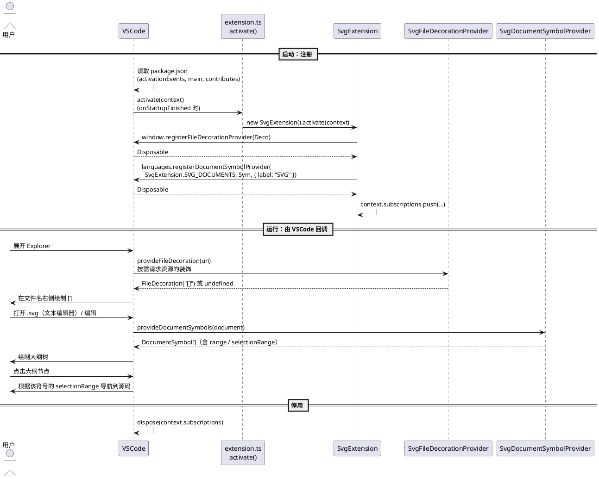

# A.3 分析：VSCode 插件的职责、设计模式与 Phase 1 复用评估

> 对应 `phase_cli_2-研-1.md` 第一部分 A.3。扩展的安装/启动步骤、示例与截图见 [`README.md`](README.md)，设计决定见 [`GUIDE.md`](GUIDE.md)。
> 文中引用的代码都在 `vscode-extension/src/` 下；Phase 1 代码在仓库根目录 `src/` 下。

---

## 1. VSCode 与插件各自的职责，以及注册与调用过程

### 1.1 职责划分

| 方面 | VSCode（宿主） | 本插件 |
|---|---|---|
| 生命周期 | 读取 `package.json` 清单；在 `activationEvents`（本插件为 `onStartupFinished`）触发时加载 `main` 指向的 `out/extension.js` 并调用 `activate(context)`；关闭窗口或停用插件时释放 `context.subscriptions` 中的资源 | 提供 `activate()`；在其中创建并注册两个提供者，把返回的 `Disposable` 交给 `context.subscriptions`（`SvgExtension.activate`） |
| 何时调用 | 决定**何时**、**对哪个对象**调用提供者：Explorer 渲染某一项时请求它的装饰；打开文档、文档变化、大纲面板显示时请求文档符号 | 不主动推送任何东西，只**按请求返回数据**：给一个 URI 返回 `FileDecoration` 或 `undefined`；给一个文档返回 `DocumentSymbol[]` |
| 界面渲染 | 绘制 Explorer、大纲树、面包屑；把 badge 画在文件名右侧；合并多个提供者的结果；处理点击大纲节点后的跳转与选中 | 不接触任何界面元素；只提供"标记文字是什么""节点叫什么、对应源码哪一段" |
| 文件与文本 | 管理文件系统、文档内容和编辑缓冲区 | 只通过 VSCode 提供的接口读取：`workspace.fs.stat` 判断是不是文件，`TextDocument.getText()` 取当前文本 |
| 出错处理 | 提供者抛异常时记录错误、该次请求失败 | 自行吞掉可预期的失败：读不到文件 → 不装饰；XML 不完整 → 空大纲；意外错误写入输出通道，不向 VSCode 抛出（`SvgDocumentSymbolProvider.provideDocumentSymbols`） |

这里的控制反转体现在注册之后。扩展把两个提供者交给 VSCode，之后由宿主发起请求，扩展返回宿主可以渲染的数据。

### 1.2 注册与调用过程



要点：

1. **注册范围。** `SvgExtension.SVG_DOCUMENTS` 的值是 `{ pattern: '**/*.[sS][vV][gG]' }`。VSCode 按路径匹配符号提供者，因此扩展覆盖 `.svg`、`.SVG` 和混合大小写的后缀。文件装饰的注册接口接收提供者对象，路径和文件类型由提供者自行判断。
2. **回调时机。** VSCode 按需请求资源装饰，也会在文档编辑后重新请求符号。符号提供者每次读取 `document.getText()`，因此未保存的改名也会反映在下一次结果中。两种请求的次数均由宿主决定。
3. **点击定位。** 扩展提供 `range`（整个元素）与 `selectionRange`（开始标签中的标签名），VSCode 负责把选定的符号定位到编辑器。v0.1.0 曾在作者机器上跳回图片预览。v0.1.1 将 `*.svg` 的默认编辑器关联设为文本编辑器，用户仍可覆盖它。在干净配置的 VSCode 1.147.0 中，用键盘选中原生大纲里的 `rect#start` 后，光标停在 `flowchart.svg` 第 5 行。[宿主验证记录](docs/evidence/vscode-host.json)
4. **释放**：注册函数返回 `Disposable`，放进 `context.subscriptions` 后由 VSCode 在停用时统一释放，插件无需自己记录要注销什么。

---

## 2. 文件装饰与 Decorator、Adapter 模式

### 2.1 本插件中的接口、对象组合与调用关系

```plantuml
@startuml classes
package "VSCode API（宿主定义的接口）" {
  interface FileDecorationProvider {
    +provideFileDecoration(uri): ProviderResult<FileDecoration>
  }
  interface DocumentSymbolProvider {
    +provideDocumentSymbols(document): DocumentSymbol[]
  }
  class FileDecoration <<值对象>>
  class DocumentSymbol <<值对象>> {
    name; kind; range; selectionRange; children
  }
}
package "插件：与 VSCode 无关的纯逻辑" {
  class SvgFileRule { +matches(path): boolean }
  class SvgOutlineParser { +parseOrEmpty(text): OutlineNode[] }
  class OutlineNode { label; span; nameSpan; children }
}
package "插件：接入 VSCode 的一层" {
  class SvgFileDecorationProvider
  class SvgDocumentSymbolProvider
}
SvgFileDecorationProvider ..|> FileDecorationProvider
SvgFileDecorationProvider o--> SvgFileRule : 组合
SvgFileDecorationProvider o--> "FileSystem.stat" : 组合（注入）
SvgFileDecorationProvider ..> FileDecoration : 创建
SvgDocumentSymbolProvider ..|> DocumentSymbolProvider
SvgDocumentSymbolProvider o--> SvgOutlineParser : 组合
SvgOutlineParser ..> OutlineNode : 产生
SvgDocumentSymbolProvider ..> DocumentSymbol : OutlineNode → DocumentSymbol
@enduml
```

- 两个提供者都实现宿主定义的接口。`SvgFileDecorationProvider` 组合纯逻辑 `SvgFileRule` 与宿主提供的文件系统，按名称筛选后异步读取 `stat`。`SvgDocumentSymbolProvider` 组合纯逻辑解析器与写入输出通道的回调，将文档文本转换为符号树。
- 纯逻辑类不 import `vscode`，因此能在没有 VSCode 的环境中做单元测试（`test/` 中的单元测试与回归测试）；`vscode` 模块在测试中由 `test/support/vscode.ts` 替代。

### 2.2 文件装饰与经典 Decorator 模式

经典 Decorator（GoF）的结构：`Component` 接口；`ConcreteComponent` 实现它；`Decorator` **同样实现 `Component`、并持有一个 `Component` 引用**，把调用转发给被装饰对象，再在转发前后附加职责。装饰器可以层层嵌套，客户端只看到 `Component` 接口，感知不到被装饰过。

| 对照点 | 经典 Decorator | VSCode 文件装饰（本插件 A.1） |
|---|---|---|
| 目的 | 不修改原类、不用子类，**动态地给对象附加职责** | 不修改文件名、文件内容和 Explorer 本身，**给文件项附加界面信息**（`[]` 标记） — **目的一致** |
| 被装饰的东西 | 一个对象（`ConcreteComponent`） | Explorer 中的一个文件项，以 URI 标识 |
| 装饰者与被装饰者的接口 | **相同**：Decorator 实现 `Component` 接口 | **不同**：`FileDecorationProvider` 与文件项没有共同接口；提供者也不持有文件项 |
| 组合方式 | 装饰器**包装**被装饰对象（对象组合，形成包装链） | 不包装：提供者被**注册到宿主**，宿主持有提供者列表 |
| 调用关系 | 客户端调用最外层装饰器，装饰器沿链**转发**给内层 | 宿主（Explorer 渲染器）按 URI **查询**所有提供者，收集返回的 `FileDecoration` 值对象，再自己绘制；没有转发 |
| 附加的是什么 | **行为**（转发前后执行额外代码） | **数据**（badge、tooltip、颜色等值对象），由宿主解释 |
| 多个装饰 | 嵌套顺序决定效果 | 多个插件可同时为同一文件提供装饰，由**宿主负责合并**，插件之间互不知道 |
| 对原对象的影响 | 透明：客户端以为在用原对象 | 透明：文件名与内容不变，其他插件看到的仍是原文件 |

两者都能在保留原对象的前提下附加职责。经典 Decorator 的组合顺序由建立包装链的一方决定，各层沿同一个接口委托调用。VSCode 的组合发生在渲染侧，提供者只需回答某个 URI 应附加哪些界面信息，收集和呈现这些信息由宿主负责。

（对照第二部分：CLI 的 `TreeDecorator` 扩展点同样是"给结构树的行追加标签、渲染器与内核不改"，设计时可以选择真正的包装链，也可以借鉴 VSCode 的"提供者 + 宿主合并"做法，两者在多个标签的拼接顺序上取舍不同。）

### 2.3 Adapter 模式

经典 Adapter：`Client` 依赖 `Target` 接口；已有的 `Adaptee` 接口不兼容；`Adapter` 实现 `Target`，内部**组合** `Adaptee`（对象适配器），把对 `Target` 的调用翻译成对 `Adaptee` 的调用。

本插件中的对应：

| 角色 | 大纲（A.2） | 文件装饰（A.1） |
|---|---|---|
| Client | VSCode 的大纲视图 / 面包屑 | VSCode 的 Explorer |
| Target | `vscode.DocumentSymbolProvider`（返回 `DocumentSymbol` 树，位置用 `vscode.Range`） | `vscode.FileDecorationProvider`（返回 `FileDecoration`） |
| Adaptee | `SvgOutlineParser` + `OutlineNode`（与 VSCode 无关的解析结果，位置用自定义的 `SourceSpan`） | `SvgFileRule`（只回答"这个路径是不是 SVG"）+ 文件系统的 `stat` |
| Adapter | `SvgDocumentSymbolProvider.toSymbol()` 转换单个节点及其两个范围。`toSymbols()` 用显式栈处理子树，按源码顺序填入 `DocumentSymbol.children` | `SvgFileDecorationProvider` 组合规则与 `stat`，异步返回 `FileDecoration('[]')` 或 `undefined` |

与经典 Adapter 的差异：

1. 这里的被适配对象包含本项目为单独测试而设计的规则和解析器。它们可以在没有 VSCode 的进程中调用。
2. 两个适配器各自处理宿主契约。装饰提供者在 `stat` 失败时返回 `undefined`。大纲中，预期的 `IncompleteXmlError` 由解析器的 `parseOrEmpty()` 转为空数组，提供者负责把其余错误写入输出通道并返回空数组。
3. VSCode 要求提供者实现约定的接口。将解析器与提供者拆开的决定属于本扩展，目的是让同一套解析逻辑可以独立验证。

---

## 3. Phase 1 的解析、模型与遍历代码能否复用

本节以 `ElastingYun/software_homework` 的 `final` 对应提交 `8edfba0` 为基线。开发初稿曾笼统写过“xmldom 不提供完整位置信息”。实验进一步确定，元素的 `lineNumber` 和 `columnNumber` 给出开始标签的位置，从 1 开始，元素结束位置需要另外计算。复现时在仓库根目录执行 `npm ci --omit=dev` 安装 CLI 的运行依赖，然后执行 `node vscode-extension/docs/evidence/xmldom-probe.mjs`。[实验脚本](docs/evidence/xmldom-probe.mjs)

| Phase 1 代码 | 能否复用于 A.2 大纲 | 依据 |
|---|---|---|
| **解析：`@xmldom/xmldom`**（第三方库） | **部分可复用** | 实测可得到开始标签 `<` 所在的行列。本扩展还需要标签名的起止位置（`selectionRange`）和整个元素的结束位置（`range`），并将行列换算成 VSCode 的零基位置。脚本中的未闭合标签、标签不匹配、未写完的属性三种输入均触发解析异常 |
| **解析：`src/io/SvgReader.ts`** | **不能复用** | ① 读入后立即转换为 `Shape` 对象，**丢弃了 xmldom 给出的位置**；② 只导入 6 种已注册图形，`path`、`defs` 等元素被**跳过**（`readChildren`：`skipped unsupported element`），而大纲要显示全部元素；③ 缺 id 时**自动分配** `rect1` 之类的 id（`resolveId`），大纲会显示源码中并不存在的 id；④ 嵌套超过 500 层直接拒绝（`MAX_DEPTH`）；⑤ `onErrorStopParsing` 会在解析器报告 `error` 时中止，普通 `warning` 可继续处理。这些都是编辑器"读入后可编辑"所需要的规则，与大纲"如实反映源码"的目标相反 |
| **模型：`src/model/` 中的 `Shape`、`GroupShape`、`SvgDocument`** | **可借鉴树结构** | 模型用纯 TypeScript 表示可编辑图形。默认注册六种图形，`SvgDocument.attach` 维护唯一的 id 索引，图形对象未保留源码范围。大纲须忠实显示源码，允许元素无 id，并要携带位置。因此扩展以 `OutlineNode` 保存标签、可选 id、范围和有序子节点 |
| **遍历：`Shape.selfAndDescendants()`、`TreeRenderer.collect()`** | **可借鉴按子节点顺序遍历的思路** | 前者返回扁平的 `Shape[]`，后者递归生成终端文本行，两者均依赖 CLI 的图形模型。扩展须保留层级与定位范围，因此 `SvgDocumentSymbolProvider.toSymbols()` 用显式栈把 `OutlineNode` 子节点按源码顺序写入对应的符号树 |
| **工程层面** | 有额外成本 | CLI 是 ESM 工程（`"type": "module"`、`NodeNext`、导入带 `.js` 后缀），扩展编译为 CommonJS；若要共享代码，需要打包工具（如 esbuild）或把公共部分抽成独立包。另外 xmldom 需要随扩展一起打包发布 |

扩展沿用了 Phase 1 按子节点顺序组织元素树的设计。即使使用 xmldom，也还要从源码补出定位范围。现版由 `LineIndex` 先建立行起始偏移索引，`OutlineScan` 随扫描记录元素范围和标签名范围。这样既保留了原始标签与可选 id，也能在编辑中直接从索引求出所需行列。

**对第二部分的启示**：如果将来希望 CLI 与插件共享解析代码，较合理的方向是把"带位置的 XML 结构扫描"抽成独立的、与平台无关的包：CLI 在其上构建可编辑模型，插件在其上构建大纲。这不在第一部分范围内，只作为建议记录。
