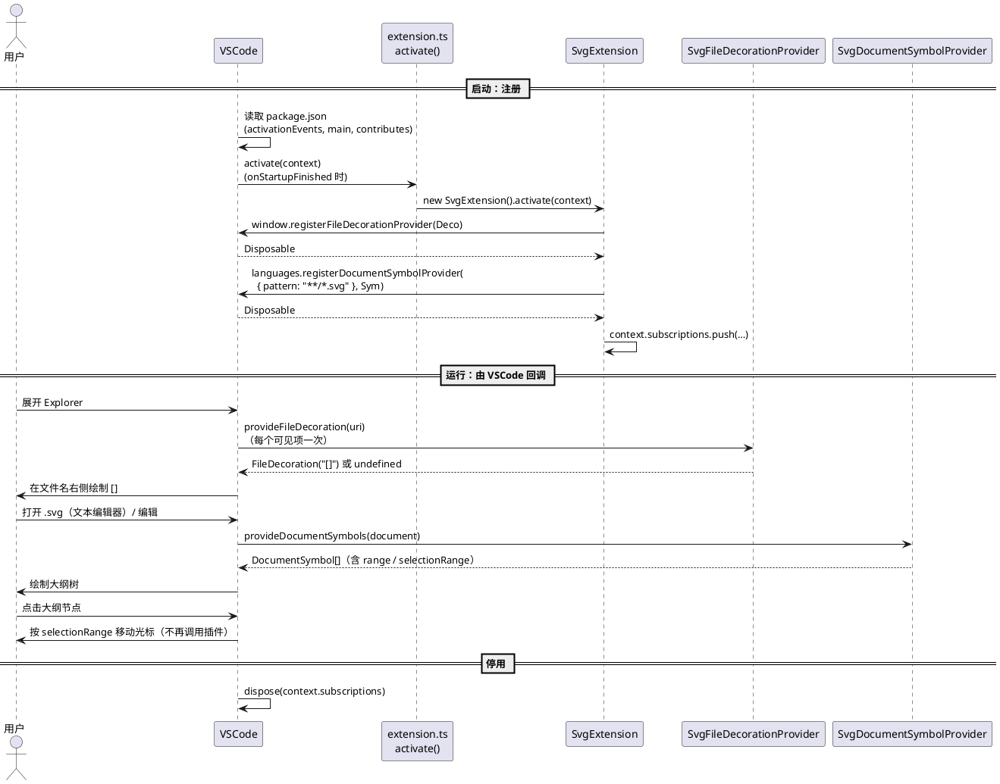

# A.3 分析：VSCode 插件的职责、设计模式与 Phase 1 复用评估

> 对应 `phase_cli_2-研-1.md` 第一部分 A.3。扩展的安装/启动步骤、示例与截图见 [`README.md`](README.md)，设计决定见 [`GUIDE.md`](GUIDE.md)。
> 文中引用的代码都在 `vscode-extension/src/` 下；Phase 1 代码在仓库根目录 `src/` 下。

---

## 1. VSCode 与插件各自的职责，以及注册与调用过程

### 1.1 职责划分

| 方面 | VSCode（宿主） | 本插件 |
|---|---|---|
| 生命周期 | 读取 `package.json` 清单；在 `activationEvents`（本插件为 `onStartupFinished`）触发时加载 `main` 指向的 `out/extension.js` 并调用 `activate(context)`；关闭窗口或停用插件时释放 `context.subscriptions` 中的资源 | 提供 `activate()`；在其中创建并注册两个提供者，把返回的 `Disposable` 交给 `context.subscriptions`（`SvgExtension.activate`） |
| 何时调用 | 决定**何时**、**对哪个对象**调用提供者：Explorer 渲染某一项时请求它的装饰；打开文档、文档变化、大纲面板显示时请求文档符号 | 不主动推送任何东西，只**按请求返回数据**：给一个 URI 返回 `FileDecoration` 或 `undefined`；给一个文档返回 `DocumentSymbol[]` |
| 界面渲染 | 绘制 Explorer、大纲树、面包屑；把 badge 画在文件名右侧；合并多个提供者的结果；处理点击大纲节点后的跳转与选中 | 不接触任何界面元素；只提供"标记文字是什么""节点叫什么、对应源码哪一段" |
| 文件与文本 | 管理文件系统、文档内容和编辑缓冲区 | 只通过 VSCode 提供的接口读取：`workspace.fs.stat` 判断是不是文件，`TextDocument.getText()` 取当前文本 |
| 出错处理 | 提供者抛异常时记录错误、该次请求失败 | 自行吞掉可预期的失败：读不到文件 → 不装饰；XML 不完整 → 空大纲；意外错误写入输出通道，不向 VSCode 抛出（`SvgDocumentSymbolProvider.provideDocumentSymbols`） |

一句话概括：**VSCode 掌握控制流（何时调用、怎样展示），插件只实现 VSCode 定义好的接口并返回数据**——这是典型的"好莱坞原则"（Don't call us, we'll call you），也是 VSCode 能同时承载成千上万个插件而不互相干扰的基础。

### 1.2 注册与调用过程



要点：

1. **注册是"把对象交给宿主"**：插件交出的是实现了 `vscode.FileDecorationProvider` / `vscode.DocumentSymbolProvider` 接口的对象，宿主保存它们并在需要时回调。注册时附带的选择器 `{ pattern: '**/*.svg' }` 让 VSCode 只在 `.svg` 文档上调用大纲提供者（GUIDE E3）。
2. **调用由 VSCode 发起、按需进行**：装饰只对 Explorer 中**可见**的项请求；文档符号在文档内容变化后由 VSCode 重新请求，所以本插件每次都从当前文本重新解析、不缓存（GUIDE E7），"编辑后大纲更新"不需要插件监听任何事件。
3. **点击跳转完全由 VSCode 完成**：插件只提供每个节点的 `range`（整个元素）与 `selectionRange`（开始标签中的标签名），跳转、选中、面包屑同步都是宿主行为。BUG-V1（点击后切换到图片预览）正是宿主的"按默认编辑器重新打开再定位"行为造成的，修正方式也是通过清单向宿主声明默认设置（`contributes.configurationDefaults`，GUIDE E11），而不是在插件里接管跳转。这一修正有一个用户可见的副作用：安装插件后，双击 `.svg` 默认以文本方式打开而不再显示图片预览；它只是默认值，用户设置可以改回去（见 README）。
4. **释放**：注册函数返回 `Disposable`，放进 `context.subscriptions` 后由 VSCode 在停用时统一释放，插件无需自己记录要注销什么。

---

## 2. 文件装饰与 Decorator、Adapter 模式

### 2.1 本插件中的接口、对象组合与调用关系

```plantuml
@startuml classes
package "VSCode API（宿主定义的接口）" {
  interface FileDecorationProvider {
    +provideFileDecoration(uri): FileDecoration | undefined
  }
  interface DocumentSymbolProvider {
    +provideDocumentSymbols(document): DocumentSymbol[]
  }
  class FileDecoration <<值对象>>
  class DocumentSymbol <<值对象>> {
    name; kind; range; selectionRange; children
  }
}
package "插件：与 VSCode 无关的纯逻辑" {
  class SvgFileRule { +matches(path): boolean }
  class SvgOutlineParser { +parseOrEmpty(text): OutlineNode[] }
  class OutlineNode { label; span; nameSpan; children }
}
package "插件：接入 VSCode 的一层" {
  class SvgFileDecorationProvider
  class SvgDocumentSymbolProvider
}
SvgFileDecorationProvider ..|> FileDecorationProvider
SvgFileDecorationProvider o--> SvgFileRule : 组合
SvgFileDecorationProvider o--> "FileSystem.stat" : 组合（注入）
SvgFileDecorationProvider ..> FileDecoration : 创建
SvgDocumentSymbolProvider ..|> DocumentSymbolProvider
SvgDocumentSymbolProvider o--> SvgOutlineParser : 组合
SvgOutlineParser ..> OutlineNode : 产生
SvgDocumentSymbolProvider ..> DocumentSymbol : OutlineNode → DocumentSymbol
@enduml
```

- 两个提供者都**实现宿主定义的接口**，并通过构造参数**组合**纯逻辑对象（规则、解析器、文件系统的 `stat`），自己只做"接口适配 + 结果转换"。
- 纯逻辑类不 import `vscode`，因此能在没有 VSCode 的环境中做单元测试（`test/` 中的单元测试与回归测试）；`vscode` 模块在测试中由 `test/support/vscode.ts` 替代。

### 2.2 文件装饰与经典 Decorator 模式

经典 Decorator（GoF）的结构：`Component` 接口；`ConcreteComponent` 实现它；`Decorator` **同样实现 `Component`、并持有一个 `Component` 引用**，把调用转发给被装饰对象，再在转发前后附加职责。装饰器可以层层嵌套，客户端只看到 `Component` 接口，感知不到被装饰过。

| 对照点 | 经典 Decorator | VSCode 文件装饰（本插件 A.1） |
|---|---|---|
| 目的 | 不修改原类、不用子类，**动态地给对象附加职责** | 不修改文件名、文件内容和 Explorer 本身，**给文件项附加界面信息**（`[]` 标记） — **目的一致** |
| 被装饰的东西 | 一个对象（`ConcreteComponent`） | Explorer 中的一个文件项，以 URI 标识 |
| 装饰者与被装饰者的接口 | **相同**：Decorator 实现 `Component` 接口 | **不同**：`FileDecorationProvider` 与文件项没有共同接口；提供者也不持有文件项 |
| 组合方式 | 装饰器**包装**被装饰对象（对象组合，形成包装链） | 不包装：提供者被**注册到宿主**，宿主持有提供者列表 |
| 调用关系 | 客户端调用最外层装饰器，装饰器沿链**转发**给内层 | 宿主（Explorer 渲染器）按 URI **查询**所有提供者，收集返回的 `FileDecoration` 值对象，再自己绘制；没有转发 |
| 附加的是什么 | **行为**（转发前后执行额外代码） | **数据**（badge、tooltip、颜色等值对象），由宿主解释 |
| 多个装饰 | 嵌套顺序决定效果 | 多个插件可同时为同一文件提供装饰，由**宿主负责合并**，插件之间互不知道 |
| 对原对象的影响 | 透明：客户端以为在用原对象 | 透明：文件名与内容不变，其他插件看到的仍是原文件 |

结论：VSCode 的"文件装饰"在**意图**上与 Decorator 一致——不修改原对象、可叠加、对原对象透明地附加东西；但在**结构**上不是 GoF Decorator：没有共同接口、没有包装链和转发，附加的是数据而不是行为。它更接近"**宿主持有一组提供者（类似 Strategy/插件注册表），按需查询并合成结果**"的结构，叠加与合并的职责在宿主而不在装饰者。这也是 VSCode 能让互不相识的插件同时装饰同一个文件的原因：如果用经典包装链，各插件必须知道彼此的包装顺序。

（对照第二部分：CLI 的 `TreeDecorator` 扩展点同样是"给结构树的行追加标签、渲染器与内核不改"，设计时可以选择真正的包装链，也可以借鉴 VSCode 的"提供者 + 宿主合并"做法，两者在多个标签的拼接顺序上取舍不同。）

### 2.3 Adapter 模式

经典 Adapter：`Client` 依赖 `Target` 接口；已有的 `Adaptee` 接口不兼容；`Adapter` 实现 `Target`，内部**组合** `Adaptee`（对象适配器），把对 `Target` 的调用翻译成对 `Adaptee` 的调用。

本插件中的对应：

| 角色 | 大纲（A.2） | 文件装饰（A.1） |
|---|---|---|
| Client | VSCode 的大纲视图 / 面包屑 | VSCode 的 Explorer |
| Target | `vscode.DocumentSymbolProvider`（返回 `DocumentSymbol` 树，位置用 `vscode.Range`） | `vscode.FileDecorationProvider`（返回 `FileDecoration`） |
| Adaptee | `SvgOutlineParser` + `OutlineNode`（与 VSCode 无关的解析结果，位置用自定义的 `SourceSpan`） | `SvgFileRule`（只回答"这个路径是不是 SVG"）+ 文件系统的 `stat` |
| Adapter | `SvgDocumentSymbolProvider`：组合解析器；`toSymbol()` 把 `OutlineNode` 递归转换为 `DocumentSymbol`，`toRange()` 把 `SourceSpan` 转换为 `vscode.Range`；把"不完整 XML"翻译为空数组 | `SvgFileDecorationProvider`：组合规则与 `stat`，把"是不是 SVG 普通文件"翻译成 `FileDecoration('[]')` 或 `undefined` |

与经典 Adapter 的差异：

1. **Adaptee 是有意设计成与宿主无关的**，而不是"无法修改的遗留类"。目的不只是"接口不兼容时补救"，而是把业务逻辑和平台隔开（端口与适配器思想）：换一个编辑器（例如 Language Server、Web 版编辑器），只需重写适配层。
2. 适配器做的不只是方法改名，而是**数据结构的递归转换**（节点树 → 符号树、位置值对象 → `Range`）以及**语义转换**（异常 → 空大纲，读不到文件 → 不装饰），比教科书中的 Adapter 更"厚"。
3. 宿主接口本身是 VSCode 预先定义的扩展点；插件**一定**要通过适配器接入，这正是 Adapter 在插件体系中的普遍用法。

---

## 3. Phase 1 的解析、模型与遍历代码能否复用

实现前的指导文档初稿判断"Phase 1 的 xmldom 不提供完整位置信息"。写本节时逐项**实际验证**（验证脚本 [`docs/evidence/xmldom-probe.mjs`](docs/evidence/xmldom-probe.mjs)，在仓库根目录运行 `node vscode-extension/docs/evidence/xmldom-probe.mjs`），修正了其中一处：**xmldom 本身会记录每个元素开始标签的行号和列号**（`lineNumber`、`columnNumber`，从 1 开始），但**不记录元素的结束位置**。逐项结论如下。

| Phase 1 代码 | 能否复用于 A.2 大纲 | 依据 |
|---|---|---|
| **解析：`@xmldom/xmldom`**（第三方库） | **部分可复用** | ✔ 能给出开始位置，可作为 `selectionRange` 的起点；✔ 遇到不完整 XML 会抛异常（实测"未闭合标签""标签不匹配""写到一半"三种输入均抛出），捕获后返回空大纲即可满足要求。✘ 没有结束位置：`DocumentSymbol.range` 需要覆盖整个元素（VSCode 用它做面包屑同步和高亮，且要求包含 `selectionRange`），只能另行计算。✘ 行列从 1 开始、按字符计数，需要换算成 VSCode 从 0 开始的 UTF-16 位置 |
| **解析：`src/io/SvgReader.ts`** | **不能复用** | ① 读入后立即转换为 `Shape` 对象，**丢弃了 xmldom 给出的位置**；② 只导入 6 种已注册图形，`path`、`defs` 等元素被**跳过**（`readChildren`：`skipped unsupported element`），而大纲要显示全部元素；③ 缺 id 时**自动分配** `rect1` 之类的 id（`resolveId`），大纲会显示源码中并不存在的 id；④ 嵌套超过 500 层直接拒绝（`MAX_DEPTH`）；⑤ 用 `onErrorStopParsing` 把所有警告都当成致命错误。这些都是编辑器"读入后可编辑"所需要的规则，与大纲"如实反映源码"的目标相反 |
| **模型：`src/model/`（`Shape`、`GroupShape`、`SvgDocument` 等 32 个类）** | **不能直接复用，设计思想可借鉴** | 模型本身是纯 TypeScript、不依赖 Node 和第三方库（依赖规则 R1，`src/model` 中 0 处 `node:` / `@xmldom` 导入），技术上可以被插件引用；但它是"可编辑的图形模型"：只有 6 种类型、没有源码位置字段、强制 id 唯一且必填（`SvgDocument.attach` 冲突即报错）。大纲需要的是"任意元素、可缺 id、可重复 id、带位置"的只读树，所以插件另建了轻量的 `OutlineNode` |
| **遍历：`Shape.selfAndDescendants()`、`TreeRenderer.collect()`** | **不能直接复用，算法思路一致** | 两者都在 `Shape` 树上工作，`TreeRenderer` 产出的是终端文本行而不是结构化节点；插件的 `SvgDocumentSymbolProvider.toSymbol()` 采用了同样的"先序、递归处理子节点"思路，在 `OutlineNode` 树上重新实现 |
| **工程层面** | 有额外成本 | CLI 是 ESM 工程（`"type": "module"`、`NodeNext`、导入带 `.js` 后缀），扩展编译为 CommonJS；若要共享代码，需要打包工具（如 esbuild）或把公共部分抽成独立包。另外 xmldom 需要随扩展一起打包发布 |

**结论**：Phase 1 中真正可能复用的是第三方解析器 xmldom（只能提供开始位置）和"Composite 树 + 先序遍历"的设计思想；Phase 1 自己的读入、模型和渲染代码都是为"命令行编辑器"设计的（只认 6 种图形、补全 id、拒绝深嵌套、丢弃位置），不适合"如实展示任意 SVG 源码结构"的大纲。因此插件采用了一个约 200 行、带位置记录、容错的扫描器（`OutlineScan`），一次扫描同时得到开始位置、结束位置和标签名位置，并且不引入额外依赖、与 CLI 工程的模块格式无关。

**对第二部分的启示**：如果将来希望 CLI 与插件共享解析代码，较合理的方向是把"带位置的 XML 结构扫描"抽成独立的、与平台无关的包：CLI 在其上构建可编辑模型，插件在其上构建大纲。这不在第一部分范围内，只作为建议记录。
